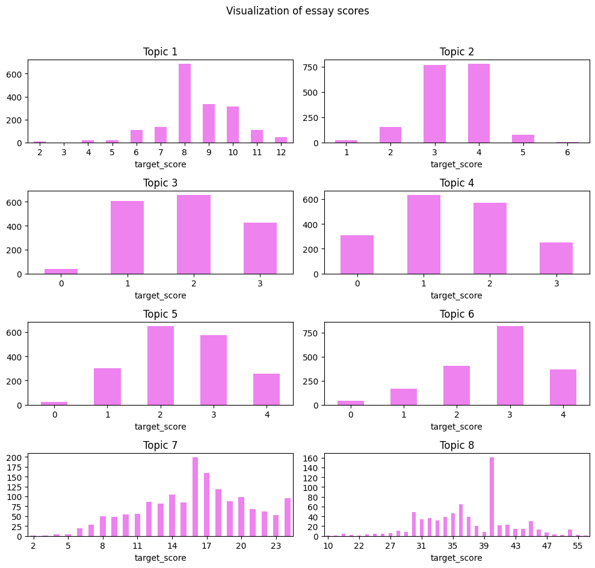
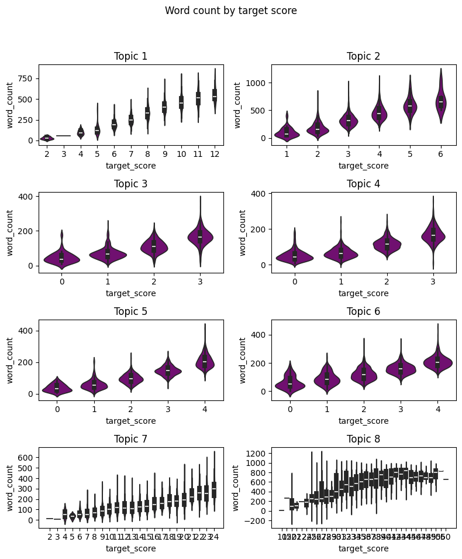
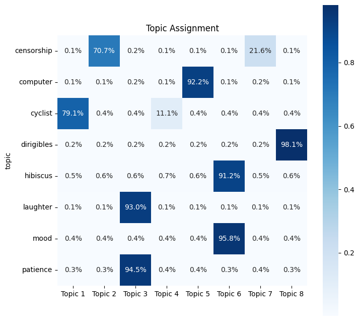

# Automated Essay Scoring with NLP and Neural Networks

An academic team project from my master's program (Spring 2024). The project predicts the grade a human rater would give a student essay. It combines natural language processing features with neural network regression and is evaluated on about 13,000 essays from the Hewlett Foundation's Automated Student Assessment Prize (ASAP) dataset.

The work covers:
- Text cleaning and grammar correction
- Linguistic feature engineering with spaCy
- Topic modeling with LDA
- Word2Vec essay embeddings
- Two neural network scoring approaches, evaluated with quadratic weighted kappa (QWK), the agreement metric used in the ASAP competition

> **Attribution:** This project builds on and adapts code from [Turanga1/Automated-Essay-Scoring](https://github.com/Turanga1/Automated-Essay-Scoring). The overall pipeline, many analysis and plotting cells, the Word2Vec preprocessing, the neural network setups and the kappa-averaging function follow that repository. See [Credits](#credits-and-references) for details.

## Project Overview

Scoring essays by hand takes a long time, and human raters do not always agree. Automated scoring systems try to reproduce human grades consistently. This project:

1. Explores the eight ASAP essay prompts and their score distributions.
2. Corrects spelling and grammar, then extracts linguistic features with spaCy.
3. Uses LDA topic modeling to see whether the essays' content separates by prompt.
4. Builds feature vectors from 31 handcrafted features plus 400-dimensional Word2Vec embeddings, for 431 features in total.
5. Trains neural networks to predict scores and compares their agreement with human raters, measured by QWK.

The full pipeline is in [`notebooks/automated-essay-scoring.ipynb`](notebooks/automated-essay-scoring.ipynb).

## My Contribution

This was a team project. I worked on:

- **Text preprocessing:** grammar and spelling correction with `language_tool_python`, and spaCy tokenization, lemmatization and part-of-speech tagging, comparing the small, medium and large English models
- **Feature engineering:** handcrafted count features (tokens, sentences, named entities, punctuation, parts of speech, anonymization tags), document similarity to a reference essay, and Word2Vec embeddings
- **Topic modeling:** LDA topic discovery and pyLDAvis visualization
- **Neural network scoring:** per-prompt dense networks with 5-fold cross-validation, the combined BiLSTM model, and kappa evaluation

The notebook also updates the reference code for current library versions: `get_feature_names_out` in scikit-learn, `pyLDAvis.lda_model`, Keras 3, and `vector_size` in gensim 4.

## Technologies Used

- **Language and environment:** Python 3.10 in Jupyter (run on Google Colab)
- **Data handling:** pandas, NumPy
- **NLP:** spaCy (`en_core_web_sm`, `md` and `lg` models), `language_tool_python`, TextBlob, NLTK, gensim (Word2Vec)
- **Topic modeling:** scikit-learn `LatentDirichletAllocation`, pyLDAvis
- **Modeling:** TensorFlow and Keras (dense network and bidirectional LSTM), scikit-learn
- **Evaluation:** quadratic weighted kappa (via `skll.metrics.kappa`)
- **Visualization:** Matplotlib, seaborn

## Dataset

**[The Hewlett Foundation: Automated Essay Scoring (ASAP)](https://www.kaggle.com/c/asap-aes)** on Kaggle.

- **Training data:** 12,974 student essays written in response to 8 prompts
- **Prompt labels used in the notebook:** computer, censorship, cyclist, hibiscus, mood, dirigibles, patience, laughter
- **Scores:** each prompt uses a different score range, from 0–3 up to 10–60. Every essay has scores from two human raters, and 128 essays have a third.
- **Anonymization:** names, places and other identifying details are replaced with tags such as `@PERSON1` and `@LOCATION1`.

The dataset is **not included** in this repository. It is competition data, so download it from Kaggle after accepting the competition rules. See [Setup](#setup).

## Approach

1. **Exploratory analysis:** essay counts, word counts and score distributions for each prompt.
2. **Language correction:** TextBlob's spell-checker was tried first and judged less accurate, so every essay was corrected with `language_tool_python` instead.
3. **spaCy processing:** tokens, lemmas, part-of-speech tags, sentences and named entities, with the small, medium and large English models compared.
4. **Document similarity:** each essay was compared with a reference essay for its prompt using spaCy vector similarity.
5. **Feature engineering:** 31 count-based features, standardized with `StandardScaler`.
6. **Topic modeling:** an 8-topic LDA model on lemmatized essays. A second LDA was fitted within the hibiscus prompt to look for links between topics and scores.
7. **Word2Vec embeddings:** a 400-dimensional skip-gram model trained on the training, validation and test essays combined. Each essay is represented by the average of its word vectors.
8. **Scoring models:**
   - **Approach 1, separate model per prompt:** a small dense network (14 ReLU units and 20% dropout) trained separately for each prompt on the 431 features. It was evaluated with a train/test split and with 5-fold cross-validation.
   - **Approach 2, one model for all prompts:** scores were rescaled to 0–10 within each prompt, and a single bidirectional LSTM (64 units) was trained on all essays with an 80/20 split.

## Results

QWK ranges from 0 (chance-level agreement) to 1 (perfect agreement). As a reference point, the notebook calculates the agreement between the two human raters at **QWK 0.761**, averaged across the prompts.

**Approach 1: separate dense network per prompt, 5-fold cross-validation**

| Prompt | QWK |
|---|---|
| computer | 0.833 |
| censorship | 0.743 |
| cyclist | 0.692 |
| hibiscus | 0.758 |
| mood | 0.807 |
| dirigibles | 0.817 |
| patience | 0.817 |
| laughter | 0.698 |
| **Combined (mean)** | **0.776** |

A single 80/20 train/test split gave a combined QWK of 0.736. In that run, the same network carried its weights from one prompt to the next.

**Approach 2: one BiLSTM for all prompts**

- Overall QWK: 0.473. The per-prompt average was close to zero.
- The notebook's own check found that **70.5%** of the true scores did not convert back to their original values after rescaling. This points to a problem in the rescaling step, so these results are not reliable.

**Other findings from the exploratory analysis and LDA**

- In every prompt, essays with higher scores tend to be longer.
- The 8-topic LDA model largely recovered the prompts. Dirigibles essays were assigned to one topic with a median probability of 98%, and computer essays to another at 92%. Two pairs of prompts shared a topic: hibiscus with mood, and patience with laughter.

## Figures

Score distribution for each prompt:



Word count by score:



LDA topic assignment (median topic probability for each prompt):



## Limitations

- **Optimistic cross-validation scores:** in the 5-fold run, the network is created once per prompt and not reset between folds. Each later fold keeps training on weights that have already seen that fold's test essays. The feature scaler and Word2Vec were also fitted on all essays before splitting.
- **Approach 2 is unreliable:** the rescaling problem described under Results means its scores should not be relied on.
- **Unequal model comparison:** the dense model was trained for 100 epochs per prompt, while the BiLSTM was trained for only 10 epochs.
- **Leftover notes:** the notebook contains `TODO` comments about swapping in a "converted audio dataset". That change was never made, and all results use the ASAP essays.
- **Not re-run for this repository:** the notebook's outputs come from the original Colab session.

## Repository Structure

```
.
├── README.md
├── requirements.txt
├── notebooks/
│   └── automated-essay-scoring.ipynb   # Full pipeline: EDA → preprocessing → LDA → Word2Vec → neural network scoring
└── images/
    ├── score-distribution-by-prompt.png
    ├── word-count-by-score.png
    └── lda-topic-assignment.png
```

**Changes to the notebook for publishing:** all code cells are exactly as in the original. To keep the file small enough for GitHub to display (15 MB down to 1.3 MB), the following outputs were removed:
- Keras training progress logs
- pip install logs
- Library warnings
- Outputs that printed student essay text

All charts and metric printouts were kept.

## Setup

The notebook was developed on Google Colab with Python 3.10. To run it locally:

```bash
python3.10 -m venv .venv && source .venv/bin/activate
pip install -r requirements.txt
python -m spacy download en_core_web_sm
python -m spacy download en_core_web_md
python -m spacy download en_core_web_lg
```

- **Java:** `language_tool_python` downloads LanguageTool on first use, and LanguageTool needs Java to run.
- **Data:** download the ASAP data from [Kaggle](https://www.kaggle.com/c/asap-aes) and put it next to the notebook, renamed to the filenames the notebook expects:

| Kaggle file | Rename to |
|---|---|
| `training_set_rel3.tsv` | `training_data.tsv` |
| `valid_set.tsv` | `validation_data.tsv` |
| `test_set.tsv` | `testing_data.tsv` |

- **Running:** run the cells in order. The notebook saves intermediate pickle files (`training_corrected.pkl`, `training_features.pkl` and others) and loads them again later.
- **Time:** grammar correction of every essay and spaCy processing with three models each take a long time.

The pinned versions in `requirements.txt` match the Colab run, with one exception. TensorFlow is pinned to 2.16.1 instead of 2.15.0, because 2.15 cannot be installed alongside Keras 3, which scikeras 0.13 needs. These requirements were checked to resolve on Python 3.10 with `pip install --dry-run`, but the notebook itself was not re-run.

## Credits and References

- **Reference implementation:** Turanga1, [*Automated-Essay-Scoring*](https://github.com/Turanga1/Automated-Essay-Scoring). The notebook adapts this repository's EDA and LDA notebook, its neural network notebook, and `bhkappa.py` (the mean quadratic weighted kappa function). About 45% of the notebook's non-trivial code lines match that repository.
- **Dataset:** The Hewlett Foundation, [Automated Student Assessment Prize: Automated Essay Scoring](https://www.kaggle.com/c/asap-aes), Kaggle, 2012.
- **LDA background:** [Latent Dirichlet Allocation (LDA)](https://towardsdatascience.com/latent-dirichlet-allocation-lda-9d1cd064ffa2), Towards Data Science. This article is cited in the notebook.
